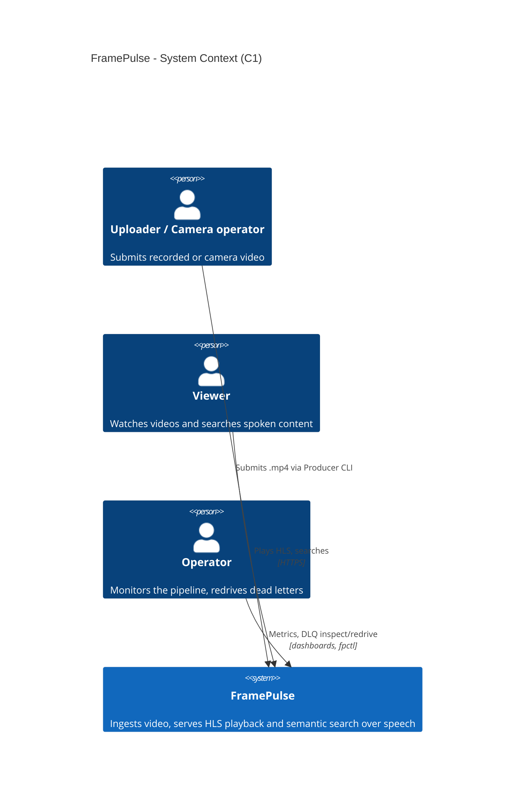
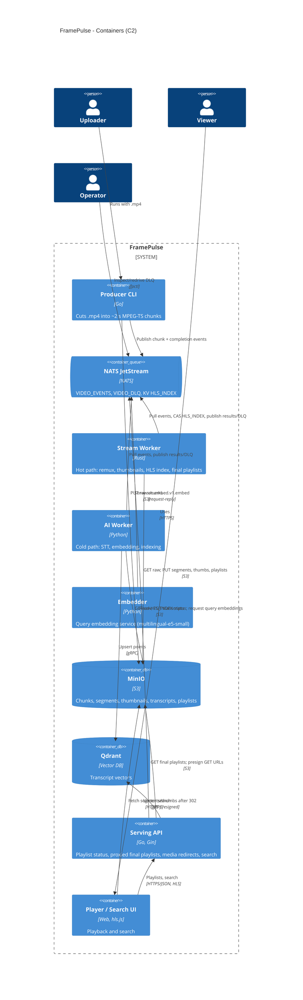

# FramePulse: System Architecture & BDD Master Specification

> Status: spec v3 (2026-10-11) — owner decisions applied; aligned with
> `docs/architecture-review.md`.
> This document states **what** the system does and how it is accepted. The detailed
> contracts (protobuf messages, stream/consumer/KV configuration, object metadata,
> Qdrant payload schema, repo layout, CI) live in `docs/architecture-review.md`
> Part B and are normative; if the two disagree, raise it and fix one of them.
> The original v1 spec is kept at `docs/framepulse_spec.v1.md`.

## 1. Project Overview & Glossary

**FramePulse** is a cloud-native, distributed video processing and semantic search
pipeline for exploring real-time stream processing, asynchronous AI analysis and
vector search with Go, Rust and Python. The hot path turns each uploaded chunk into an
HLS segment within seconds, so a video becomes playable on demand (VOD) shortly after
its upload finishes; the cold path makes its speech searchable shortly after. The MVP
is VOD-only; live playback of in-progress uploads is Future Work (Section 6).

### Key Terminology
- **Producer (Go CLI):** Accepts an `.mp4` file (or camera feed), cuts it **without
  re-encoding** into ~2 s MPEG-TS chunks (H.264 + AAC, each starting on a keyframe),
  uploads each chunk to MinIO, then publishes a `VideoChunkUploaded` event. Publishes
  `VideoIngestCompleted` after the last chunk.
- **Chunk:** One ~2 s MPEG-TS piece of a video, identified by `video_id` (UUIDv7) and
  `chunk_seq` (0-based, contiguous). Durations are measured from timestamps, never assumed.
- **NATS JetStream:** Durable event log. Stream `VIDEO_EVENTS` carries all pipeline
  events; stream `VIDEO_DLQ` holds dead letters; KV bucket `HLS_INDEX` holds per-video
  segment state (READY/FAILED, measured durations, finalized flag).
- **Durable consumer:** A named JetStream pull consumer. Each path has its own
  (`hls-stream-worker`, `ai-indexer`), so both receive every event; replicas of a
  worker share their path's consumer and split the load.
- **Stream Worker (Rust) — hot path:** Validates each chunk, **remuxes** it into an HLS
  segment (single rendition `src`), extracts one thumbnail, records the segment in
  `HLS_INDEX`, and writes the static playlists when the video is finalized.
- **AI Worker (Python) — cold path:** Extracts audio, transcribes it (faster-whisper,
  language auto-detected), embeds the transcript (`intfloat/multilingual-e5-small`),
  stores the transcript in MinIO and the vector in Qdrant.
- **Embedder (Python):** Same image as the AI Worker, different entrypoint. Serves
  query embeddings over NATS request-reply so search queries and indexed transcripts
  use the same model and the same prefix rules.
- **Object Storage (MinIO):** Private S3-compatible storage for raw chunks, HLS
  segments, thumbnails, transcripts and finalized playlists.
- **Vector Database (Qdrant):** One point per spoken chunk, accessed via alias
  `transcripts` (physical collection `transcripts_me5s384_v1`).
- **Serving API (Go + Gin):** Reports a video's processing status from `HLS_INDEX`
  until it is finalized, then serves its static playlists by proxying them from MinIO;
  redirects segment and thumbnail requests to presigned MinIO URLs; serves semantic search.
- **Dead Letter Queue (DLQ):** Stream `VIDEO_DLQ`. A worker publishes a `DeadLetter`
  there for a permanent failure, or after 5 delivery attempts; operators can redrive.
- **Finalization:** Once `VideoIngestCompleted` has arrived and every chunk is READY or
  FAILED, the Stream Worker writes the static VOD playlists (`#EXT-X-ENDLIST`) to MinIO
  and marks the index finalized. Only then is the video playable. If a video sees no
  activity for 5 minutes (`FINALIZE_IDLE_TIMEOUT`), it is **force-finalized** with the
  chunks it has (see 2.2).

---

## 2. System Architecture (Hot Path vs. Cold Path)

```text
 [Producer CLI (Go)] --PUT raw chunk--> [MinIO fp-raw]
        | publish VideoChunkUploaded / VideoIngestCompleted
        v
 [NATS JetStream]  stream VIDEO_EVENTS  (+ KV HLS_INDEX, stream VIDEO_DLQ)
        |
        +-- consumer hls-stream-worker --+-- consumer ai-indexer --------+
        v (Hot Path)                                    v (Cold Path)
 [Stream Worker (Rust)]                         [AI Worker (Python)]
  |- verify sha256, ffprobe                      |- extract audio (ffmpeg)
  |- remux -> HLS segment (src)                  |- STT (faster-whisper, auto language)
  |- thumbnail (first keyframe)                  |- embed (multilingual-e5-small, 384-d)
  |- CAS update HLS_INDEX                        |- transcript -> MinIO
  |- publish ChunkHlsReady                       |- upsert point -> Qdrant
  '- on finalization: static playlists           '- publish ChunkTranscriptIndexed
        |                                               |
        v                                               v
 [MinIO fp-media]                                [Qdrant: transcripts]
        |                                               |
        +--------------------+--------------------------+
                             v
 [Serving API (Go, Gin)] <--NATS req/reply--> [Embedder (Python)]
        |  reads HLS_INDEX status, proxies final playlists,
        |  presigns MinIO URLs, queries Qdrant
        v
 [HLS Player & Search UI]
```

### 2.1 Contract essentials (details: `docs/architecture-review.md` Part B)

| Kind | Name | Notes |
|---|---|---|
| Stream | `VIDEO_EVENTS` | subjects `video.chunks.>`, `video.lifecycle.>`; limits retention, 7 d |
| Stream | `VIDEO_DLQ` | subject `dlq.{consumer}.{video_id}`; 7 d |
| Stream | `FP_ADVISORIES` | JetStream MAX_DELIVERIES advisories, alerting only; 7 d |
| KV | `HLS_INDEX` | key `{video_id}.{rendition}`; per-segment status, durations, `finalized`; updated by compare-and-set |
| Subject | `video.chunks.uploaded.{video_id}` | `VideoChunkUploaded` (Producer) |
| Subject | `video.chunks.hls.ready.{video_id}` | `ChunkHlsReady` (Stream Worker) |
| Subject | `video.chunks.ai.indexed.{video_id}` | `ChunkTranscriptIndexed` (AI Worker) |
| Subject | `video.lifecycle.completed.{video_id}` | `VideoIngestCompleted` (Producer) |
| Subject | `svc.embed.v1.embed` | core NATS request-reply, not stored (Embedder) |
| Consumer | `hls-stream-worker` | filters `uploaded.*` and `lifecycle.completed.*` |
| Consumer | `ai-indexer` | filters `uploaded.*` |

Payloads are protobuf (`application/protobuf`), schema named in header `Fp-Schema`,
deduplicated by a deterministic `Nats-Msg-Id` (e.g. `uploaded:{video_id}:{seq6}`).

**Object keys** (`seq6` = zero-padded 6-digit 0-based `chunk_seq`):

| Artifact | Key |
|---|---|
| Raw chunk | `fp-raw/videos/{video_id}/chunks/{seq6}.ts` |
| HLS segment | `fp-media/videos/{video_id}/hls/{rendition}/{seq6}.ts` |
| Thumbnail | `fp-media/videos/{video_id}/thumbs/{seq6}.jpg` |
| Transcript | `fp-media/videos/{video_id}/transcripts/{seq6}.json` |
| Playlists (written at finalization, kept) | `fp-media/videos/{video_id}/hls/{rendition}/playlist.m3u8`, `.../hls/master.m3u8` |

**Serving API** (MinIO is never exposed directly; MVP is VOD-only):

| Endpoint | Behavior |
|---|---|
| `GET /api/v1/videos/{id}/hls/master.m3u8` | Unknown video: 404. Not finalized: 409 + JSON status. Finalized: 200, content of `fp-media/.../hls/master.m3u8` proxied verbatim |
| `GET /api/v1/videos/{id}/hls/{rendition}/playlist.m3u8` | Same rules (unknown rendition: 404); finalized: 200, static VOD playlist with `#EXT-X-ENDLIST`, proxied verbatim |
| `GET /api/v1/videos/{id}/hls/{rendition}/{seq6}.ts` | 302 to presigned MinIO GET (10 min) |
| `GET /api/v1/videos/{id}/thumbs/{seq6}.jpg` | 302 to presigned GET; placeholder image if missing |
| `GET /api/v1/search?q=&limit=10` | Semantic search; `/api/search` is an alias |

Playlist responses:
- **404** — no `HLS_INDEX` key for `{id}.{rendition}` (the master uses `{id}.src`).
- **409 Conflict** — key exists, `finalized=false`. Headers `Content-Type: application/json`,
  `Cache-Control: no-store`, `Retry-After: 5`. Body:
  `{"video_id":"…","status":"processing","segments_ready":4,"segments_failed":0,"expected_chunk_count":5}`
  (`expected_chunk_count` is `null` until `VideoIngestCompleted` has been processed).
- **200** — `finalized=true`. The API GETs the playlist object from MinIO and returns its
  bytes unchanged with `Content-Type: application/vnd.apple.mpegurl` and
  `Cache-Control: max-age=86400`. It proxies instead of redirecting so the playlists'
  relative URIs (`src/playlist.m3u8`, `000000.ts`) resolve against the API URL and reach
  the API's segment routes, which 302 to presigned URLs.
- **503** — finalized but the object is missing (an invariant violation; logged and alerted).

Search results can refer to videos that are not finalized yet. Every result carries a
`status` field read from `HLS_INDEX`: `processing` (not finalized; `playback_url` returns
409), `ready` (finalized and playable) or `failed` (finalized with no playable segment;
`playback_url` returns 410). Results are never hidden because of their status.

### 2.2 Processing rules
- **Fan-out:** Every `VideoChunkUploaded` goes to both durable consumers; neither path
  waits on the other. The AI Worker records the thumbnail key from its fixed pattern
  without waiting for the hot path.
- **Ordering of side effects (both workers):** write outputs → update KV (hot path only) →
  publish result event and wait for the PubAck → ack the input.
- **Idempotency:** Fixed object keys, `Nats-Msg-Id`s and Qdrant point IDs
  (UUIDv5 of `{video_id}:{seq6}`), and set-semantic KV updates, so a redelivery
  overwrites the same outputs with the same content.
- **Out-of-order processing:** Chunks of one video may be processed in any order by any
  replica; `HLS_INDEX` keeps segments sorted by `chunk_seq`, so ordering is applied when
  the playlists are rendered, not when chunks arrive.
- **Finalization (Stream Worker):** After every `HLS_INDEX` update (segment READY or
  FAILED, or `VideoIngestCompleted` recorded as `expected_chunk_count`) the worker checks
  whether `expected_chunk_count` is known, every chunk `0..n-1` is READY or FAILED, and
  the index is not yet finalized. If so it:
  1. renders the playlists deterministically from the index: `#EXT-X-PLAYLIST-TYPE:VOD`,
     segments in `chunk_seq` order, `EXTINF` = measured duration,
     `#EXT-X-TARGETDURATION` = ceiling of the largest `EXTINF`, FAILED chunks omitted and
     the next READY segment preceded by `#EXT-X-DISCONTINUITY`, `#EXT-X-ENDLIST`; relative URIs only;
  2. PUTs `playlist.m3u8`, then `master.m3u8` (one variant `src/playlist.m3u8`);
  3. CAS-sets `finalized=true`.

  Because rendering is deterministic, two replicas finalizing at the same time, or a
  redelivery, write identical bytes. Because the flag is set last, the API never
  proxies a missing playlist. The index records `finalize_reason = COMPLETED`.
- **Idle-timeout finalization (decided 2026-10-11):** Every `HLS_INDEX` update stamps
  `last_activity_at`. Each Stream Worker replica runs a sweeper every 30 s
  (`FINALIZE_SWEEP_INTERVAL`) over non-finalized keys. A key whose `last_activity_at` is
  older than `FINALIZE_IDLE_TIMEOUT` (default **5 min**) is force-finalized:
  1. `n` = `expected_chunk_count` if known, otherwise highest seen `chunk_seq` + 1;
  2. any chunk in `0..n-1` that is missing or still pending is treated as FAILED (omitted,
     next READY segment preceded by `#EXT-X-DISCONTINUITY`);
  3. playlists are rendered and written exactly as above, then `finalized=true` with
     `finalize_reason = IDLE_TIMEOUT` is CAS-set (concurrent sweepers are harmless);
  4. if no chunk is READY, no playlist is written; the index is finalized with
     `finalize_reason = IDLE_TIMEOUT` and zero segments, and the playlist endpoints
     return **410 Gone** with `{"status":"failed"}`.
  The 5 min default is far longer than the worst-case hot-path retry span (~25 s).
  Events arriving after finalization do not reopen the video: a late chunk is still
  processed (segment and thumbnail written) but the index and playlists are unchanged,
  and it is counted in metric `fp_late_chunks_total` with a warning log; a late
  `VideoIngestCompleted` is acked as a no-op.
- **Failures:** Permanent errors (invalid media, missing object, checksum mismatch, bad
  schema) → `DeadLetter` to `VIDEO_DLQ`, then `Term()`. Transient errors → `Nak` with
  backoff. A worker sends a message to the DLQ on receipt if it has already been
  delivered more than 5 times (catches crash loops). ffmpeg/ffprobe always run as
  separate processes with a hard timeout, so bad media cannot crash a worker. When the
  Stream Worker dead-letters a chunk, it also marks that chunk FAILED in `HLS_INDEX`.
- **Latency targets** (wording to be revisited during development):
  - Hot path: p99 **500 ms** from publish to delivery, measured from the stream
    timestamp. p95 **1.5 s** from publish until the segment is READY in `HLS_INDEX`
    (segment and thumbnail in MinIO). A video becomes playable about one such
    latency after its last chunk is published.
  - Cold path: p95 **5 s** from publish to `ChunkTranscriptIndexed`, measured with the
    default `WHISPER_MODEL=small` (int8, CPU) when the consumer has no backlog.
- **Scaling:** Workers scale horizontally on consumer `num_pending` (KEDA); backpressure
  comes from fetch size and `max_ack_pending`.

### 2.3 Models
- **Speech-to-text:** faster-whisper, multilingual models only (never `.en` variants).
  Env `WHISPER_MODEL` = `tiny` | `base` | `small` | `medium` | `large-v3`, default
  `small`, compute type int8 on CPU. Weights for the models listed in image build arg
  `WHISPER_MODELS` (default `small`) are baked into the image; the worker refuses to
  start if `WHISPER_MODEL` is not baked in (no runtime downloads). Language is
  auto-detected per chunk and stored as `language` in the transcript, the
  `ChunkTranscriptIndexed` event and the Qdrant payload. `stt_model` records the model
  actually used (e.g. `faster-whisper/small/int8`). Changing `WHISPER_MODEL` only
  affects newly processed chunks and needs no collection change.
- **Embedding:** `intfloat/multilingual-e5-small` — 384-d, cosine, mean pooling + L2
  normalization. The shared Python embedding module (used by both the AI Worker and the
  Embedder) prepends `query: ` for `PURPOSE_QUERY` and `passage: ` for `PURPOSE_PASSAGE`;
  callers always send unprefixed text. This is **not a runtime setting**: the model is
  pinned in code and in the collection name `transcripts_me5s384_v1`. Changing it means a
  new collection, re-embedding the stored transcripts, then an alias swap. The AI Worker
  and the Embedder refuse to start if alias `transcripts` does not point at their model's
  collection.
- **Library (to be verified by the developer):** the Python library that runs the
  embedding model is not fixed yet. As of 2026-10-11 fastembed's built-in list does not
  include this model (only `multilingual-e5-large`). Preferred order: fastembed custom
  ONNX model → onnxruntime + `tokenizers` → sentence-transformers (adds PyTorch to the
  image). The choice must reproduce reference sentence-transformers vectors
  (cosine ≥ 0.999) on a committed golden set.

### 2.4 Retention

| Store | Retention | Reason |
|---|---|---|
| `VIDEO_EVENTS` | 7 d | Replay window for reprocessing |
| `VIDEO_DLQ` | 7 d | Operators must redrive within a week (alert on new dead letters) |
| `FP_ADVISORIES` | 7 d | Alerting only |
| `fp-raw` bucket | 10 d lifecycle expiry | Must stay longer than `VIDEO_DLQ` so a redrive finds the raw chunk |
| `fp-media` bucket (segments, thumbnails, transcripts, playlists) | Until the video is deleted | Deletion is Future Work |
| Qdrant points | Until the video is deleted | Deletion is Future Work |

After 7 d, reprocessing does not use stream replay: re-embedding reads the stored
transcripts, and re-transcription reads the HLS segments in `fp-media` (remuxed, so the
audio is identical to the raw chunk).

---

## 3. C4 Model

Big picture only; internals are covered in Section 2 and the review document.

### 3.1 C1 — System Context

There are **no external systems**: speech-to-text and embedding models run inside
FramePulse (weights baked into the image at build time), and storage and messaging are
self-hosted parts of the system.



```text
  [Uploader / Camera operator]     [Viewer]            [Operator]
              |                       |                     |
   submits .mp4 (Producer CLI)   plays HLS, searches   metrics, DLQ redrive
              |                    (HTTPS)                  |
              v                       v                     v
  +------------------------------------------------------------------+
  |                            FramePulse                            |
  | ingest -> HLS playback + semantic search over transcribed speech |
  +------------------------------------------------------------------+
               (no external systems: models and storage run in-house)
```

### 3.2 C2 — Containers



```text
 Uploader --.mp4--> [Producer CLI (Go)] --PUT raw chunks (S3)------------> [MinIO]
                            | publish events                                 ^  ^  ^
                            v                                                |  |  |
 Operator --fpctl--> [NATS JetStream: VIDEO_EVENTS | VIDEO_DLQ | KV HLS_INDEX]  |  |
                       ^        ^          ^          ^                      |  |  |
       pull/CAS/publish|  pull/ |  req/reply|   read KV/|                    |  |  |
                       |publish |  embed    |   request |                    |  |  |
   [Stream Worker (Rust)]--GET raw; PUT segs/thumbs/playlists-------------+  |  |
   [AI Worker (Python)] --GET raw; PUT transcripts--------------------------+  |
          | upsert (gRPC)       [Embedder (Python)]                           |
          v                                                                   |
      [Qdrant] <--vector search-- [Serving API (Go, Gin)] --m3u8 GET/presign-+
                                         ^
                       HTTPS JSON + HLS  |   segments/thumbs via 302 -> MinIO
 Viewer --> [Player / Search UI (web, hls.js)]
```

---

## 4. BDD Specifications (Gherkin)

Testing is **Kubernetes-only**; there is no docker compose or testcontainers
environment.
- **Unit tests** per service run without any infrastructure (NATS, S3 and Qdrant behind
  interfaces with in-memory fakes; tests that run ffmpeg use committed fixture media).
- **Acceptance tests** (these features, run with godog) execute against a local
  **`kind`** cluster, on developer machines and in CI alike. The cluster runs the same
  Helm chart as production (`deploy/helm/framepulse`) with `values-kind.yaml`: NATS
  (+ NACK), MinIO, Qdrant, KEDA and all FramePulse services. In CI the runner is an
  in-cluster Job; developers may run it from the host via `kubectl port-forward`.
- Fault-injection steps (e.g. "Qdrant is unavailable") scale the workload to zero with
  `kubectl` and restore it afterwards.
- "Then" steps wait on result events through an ordered consumer filtered by
  `video_id`, never on fixed sleeps.
- Latency scenarios are tagged `@load` and run only in dedicated load runs, not single
  events or per-PR jobs.

### Feature 1: Ingestion and HLS Generation (Hot Path)
```gherkin
Feature: Chunk processing into HLS segments
  As a viewer
  I want uploaded video to be turned into HLS segments within seconds
  So that it is playable on demand shortly after the upload finishes

  Background:
    Given the FramePulse Helm chart is deployed to the kind test cluster and all pods are ready
    And a new video_id "V" has been assigned by the Producer CLI

  Scenario: A valid video becomes HLS segments and plays as VOD after finalization
    When the Producer CLI ingests "sample_1080p.mp4" (H.264 + AAC) as video "V"
    Then the raw object "fp-raw/videos/V/chunks/000000.ts" exists with content-type "video/mp2t"
    And a "VideoChunkUploaded" event for chunk 0 is published on "video.chunks.uploaded.V"
    And the Stream Worker writes "fp-media/videos/V/hls/src/000000.ts" by remuxing, without re-encoding
    And writes the thumbnail "fp-media/videos/V/thumbs/000000.jpg"
    And "HLS_INDEX" key "V.src" lists chunk 0 as READY with its measured duration
    And a "ChunkHlsReady" event for chunk 0 is published on "video.chunks.hls.ready.V"
    When "HLS_INDEX" key "V.src" is marked finalized
    Then GET "/api/v1/videos/V/hls/src/playlist.m3u8" returns 200 with "#EXT-X-PLAYLIST-TYPE:VOD" and "#EXT-X-ENDLIST"
    And the response body is byte-identical to the object "fp-media/videos/V/hls/src/playlist.m3u8"
    And the playlist references "000000.ts" with an EXTINF equal to the measured duration
    And GET "/api/v1/videos/V/hls/src/000000.ts" returns 302 to a presigned MinIO URL

  @load
  Scenario: Hot-path latency targets under nominal load
    When the Producer CLI publishes 300 chunks at real-time rate (one per 2 s per video, 5 videos)
    Then p99 publish-to-delivery latency for consumer "hls-stream-worker" is at most 500 ms
    And p95 publish-to-ready latency (segment READY in HLS_INDEX) is at most 1.5 s

  Scenario: Out-of-order chunks still produce an ordered playlist
    When chunks 2, 0 and 1 of video "V" are processed in that order by different replicas
    And "VideoIngestCompleted" with chunk_count 3 is delivered
    Then "HLS_INDEX" key "V.src" lists chunks 0, 1, 2 in order exactly once each
    And the static playlist "fp-media/videos/V/hls/src/playlist.m3u8" lists "000000.ts", "000001.ts", "000002.ts" in order

  Scenario: A corrupted chunk is dead-lettered without crashing the worker
    Given video "V" has 6 chunks and the raw chunk object for chunk 3 contains invalid media bytes
    When the "VideoChunkUploaded" events for chunks 0 to 5 and "VideoIngestCompleted" with chunk_count 6 are published
    Then the Stream Worker's ffprobe process fails on chunk 3 and is classified as "ERROR_CLASS_INVALID_MEDIA"
    And a "DeadLetter" is published on "dlq.hls-stream-worker.V" with redrivable = false
    And the original message is terminated, not redelivered
    And chunk 3 is recorded as FAILED in "HLS_INDEX"
    And the Stream Worker remains healthy and processes chunks 4 and 5 normally
    And the video is finalized with a static playlist that omits "000003.ts"
    And that playlist has "#EXT-X-DISCONTINUITY" immediately before "000004.ts"
```

### Feature 2: Video Finalization and Playlist Status
```gherkin
Feature: Video finalization
  As a viewer
  I want a finished upload to become a complete, closed HLS stream
  So that players treat it as on-demand video

  Scenario: Playlist requests before finalization report processing status
    Given chunks 0 and 1 of video "V" are READY in "HLS_INDEX" and no "VideoIngestCompleted" has been processed
    When the client sends GET "/api/v1/videos/V/hls/src/playlist.m3u8"
    Then the API responds 409 with Content-Type "application/json" and "Cache-Control: no-store"
    And the body has status "processing", segments_ready 2, segments_failed 0 and expected_chunk_count null
    And GET "/api/v1/videos/V/hls/master.m3u8" responds the same way
    And GET "/api/v1/videos/{an unknown UUIDv7}/hls/master.m3u8" responds 404

  Scenario: VideoIngestCompleted finalizes the video
    Given chunks 0 to 4 of video "V" are READY in "HLS_INDEX"
    When the Producer publishes "VideoIngestCompleted" with chunk_count 5 on "video.lifecycle.completed.V"
    Then the Stream Worker writes "fp-media/videos/V/hls/src/playlist.m3u8" with 5 segments, "#EXT-X-PLAYLIST-TYPE:VOD" and "#EXT-X-ENDLIST"
    And writes "fp-media/videos/V/hls/master.m3u8" with exactly one variant "src/playlist.m3u8"
    And only after both objects exist is "HLS_INDEX" key "V.src" marked finalized
    And GET "/api/v1/videos/V/hls/src/playlist.m3u8" returns 200 with the content of that object, not a redirect
    And GET "/api/v1/videos/V/hls/master.m3u8" returns 200 and its variant URI resolves to "/api/v1/videos/V/hls/src/playlist.m3u8"

  Scenario: Completion arrives before the last chunk is processed
    Given chunks 0 to 3 of video "V" are READY and chunk 4 is still being processed
    When "VideoIngestCompleted" with chunk_count 5 is delivered
    Then no static playlist is written yet
    And GET "/api/v1/videos/V/hls/src/playlist.m3u8" responds 409 with expected_chunk_count 5
    When chunk 4 becomes READY
    Then the static playlist is written once, with 5 segments and "#EXT-X-ENDLIST"
    And GET "/api/v1/videos/V/hls/src/playlist.m3u8" returns 200

  Scenario: An abandoned upload is force-finalized after the idle timeout
    Given the Stream Worker runs with FINALIZE_IDLE_TIMEOUT "5m"
    And chunks 0, 1 and 3 of video "V" are READY and no "VideoIngestCompleted" has been published
    When no event for video "V" arrives for 5 minutes
    Then the video is finalized with finalize_reason IDLE_TIMEOUT
    And the static playlist lists "000000.ts", "000001.ts" and "000003.ts" with "#EXT-X-DISCONTINUITY" before "000003.ts"
    And the playlist ends with "#EXT-X-ENDLIST"
    And GET "/api/v1/videos/V/hls/src/playlist.m3u8" returns 200

  Scenario: An abandoned upload with no playable chunk is reported as failed
    Given chunk 0 of video "V" is FAILED, no other chunk exists and the idle timeout has passed
    Then the video is finalized with finalize_reason IDLE_TIMEOUT and no playlist object is written
    And GET "/api/v1/videos/V/hls/src/playlist.m3u8" responds 410 with status "failed"

  Scenario: A chunk arriving after finalization does not reopen the video
    Given video "V" was force-finalized after the idle timeout
    When a "VideoChunkUploaded" event for a new chunk of video "V" is delivered
    Then the static playlist is unchanged and "HLS_INDEX" key "V.src" stays finalized
    And metric "fp_late_chunks_total" is incremented
```

### Feature 3: Asynchronous Transcription and Vector Indexing (Cold Path)
```gherkin
Feature: Asynchronous transcription and vector indexing
  As a viewer
  I want spoken audio to be transcribed and indexed automatically
  So that I can search inside video content

  Scenario: A chunk with speech is transcribed and indexed
    Given the AI Worker runs with the default WHISPER_MODEL "small"
    And chunk 42 of video "V" contains English speech about "data pipelines"
    When its "VideoChunkUploaded" event is delivered to consumer "ai-indexer"
    Then the AI Worker extracts the audio track and transcribes it with "faster-whisper/small/int8"
    And the detected language "en" is recorded in the transcript
    And writes the transcript to "fp-media/videos/V/transcripts/000042.json"
    And embeds the text with "intfloat/multilingual-e5-small" using the "passage: " prefix
    And upserts one Qdrant point with id UUIDv5("V:000042") into alias "transcripts" (collection "transcripts_me5s384_v1")
    And the point payload has thumbnail_key "videos/V/thumbs/000042.jpg", language "en" and the chunk's start_ms/end_ms
    And "ChunkTranscriptIndexed" with outcome INDEXED, embedding_model "intfloat/multilingual-e5-small" and qdrant_collection "transcripts_me5s384_v1" is published on "video.chunks.ai.indexed.V"

  Scenario: Chunks without speech produce no vector
    When a chunk with silent audio is indexed
    Then "ChunkTranscriptIndexed" is published with outcome NO_SPEECH and no Qdrant point is created
    When a chunk with no audio track is indexed
    Then "ChunkTranscriptIndexed" is published with outcome NO_AUDIO and no transcript is written

  @load
  Scenario: Cold-path latency target without backlog
    Given the AI Worker runs with the default WHISPER_MODEL "small" (int8, CPU)
    And consumer "ai-indexer" has no pending messages
    When 50 speech chunks are published one at a time
    Then p95 latency from publish to "ChunkTranscriptIndexed" is at most 5 seconds
```

### Feature 4: Failure Handling and Dead Letters
```gherkin
Feature: Failure handling on both paths
  As an operator
  I want failing events isolated with enough context to fix and replay them
  So that one bad input or outage does not stall or crash the pipeline

  Scenario: AI Worker failure is retried, then dead-lettered, without affecting the hot path
    Given Qdrant is unavailable
    When a "VideoChunkUploaded" event for chunk 7 of video "V" is published
    Then the AI Worker NAKs it with increasing backoff delays
    And after the 5th delivery publishes a "DeadLetter" on "dlq.ai-indexer.V" with "ERROR_CLASS_RETRIES_EXHAUSTED"
    And the dead letter contains the original subject, headers and payload verbatim
    And the Stream Worker still produces "ChunkHlsReady" for chunk 7

  Scenario: Crash loop is broken by the delivery cap
    Given a message that makes the AI Worker process exit before acking
    When it has been delivered more than 5 times
    Then the next worker to receive it sends it to the DLQ before processing and terminates it

  Scenario: Redriving dead letters after recovery
    Given dead letters from consumer "ai-indexer" exist and Qdrant is available again
    When the operator runs "fpctl dlq redrive --consumer ai-indexer --since 1h"
    Then the original payloads are republished to their original subjects
    And each affected chunk is eventually indexed exactly once
```

### Feature 5: Idempotent Redelivery
```gherkin
Feature: Idempotent processing
  As an operator
  I want redelivered or duplicate events to be harmless
  So that at-least-once delivery never creates duplicate outputs

  Scenario: Duplicate publish is deduplicated by the stream
    When the Producer publishes "VideoChunkUploaded" for chunk 5 of video "V" twice with the same Nats-Msg-Id
    Then "VIDEO_EVENTS" stores exactly one message for that chunk

  Scenario Outline: Redelivery after a crash before ack produces no duplicates
    Given chunk 5 of video "V" has been fully processed by <worker> but not acked
    When the event is redelivered to <worker>
    Then the same object keys are overwritten with equivalent content
    And <state_check>
    And the result event is deduplicated, so "VIDEO_EVENTS" holds exactly one <result_event> for chunk 5

    Examples:
      | worker        | state_check                                                | result_event           |
      | Stream Worker | "HLS_INDEX" key "V.src" lists chunk 5 exactly once          | ChunkHlsReady          |
      | AI Worker     | Qdrant holds exactly one point with id UUIDv5("V:000005")   | ChunkTranscriptIndexed |
```

### Feature 6: Semantic Search (Serving Layer)
```gherkin
Feature: Semantic search over processed videos
  As a viewer
  I want to search for topics spoken in videos
  So that I can jump directly to the right moment

  Background:
    Given chunks 42 to 49 of video "V" are indexed, spanning media time 85.000 s to 100.000 s
    And their transcripts discuss "data pipeline architecture"
    And their thumbnails exist in MinIO

  Scenario: Search returns merged time ranges with snippet and thumbnail
    When the user sends GET "/api/v1/search?q=architecture"
    Then the Serving API embeds the query via "svc.embed.v1.embed" with purpose QUERY
    And returns 200 with a result for video "V" containing:
      | Field         | Expected Value                                             |
      | start_ms      | 85000                                                      |
      | end_ms        | 100000                                                     |
      | timestamp     | 00:01:25 - 00:01:40                                        |
      | snippet       | contains "data pipeline"                                   |
      | thumbnail_url | /api/v1/videos/V/thumbs/{seq6}.jpg for a chunk in 42..49   |
      | playback_url  | /api/v1/videos/V/hls/master.m3u8 with a start-time hint    |
      | status        | ready                                                      |
    And adjacent matching chunks of the same video appear as one range, not 8 results

  Scenario: Search shows videos that are still processing, with their status
    Given chunks of video "W" are indexed but video "W" is not finalized yet
    When the user sends GET "/api/v1/search?q=architecture"
    Then the result for video "W" is included with status "processing"
    And its playback_url responds 409 until the video is finalized

  Scenario: Thumbnail URL redirects to a presigned MinIO URL
    When the client requests the thumbnail_url of the result
    Then the API responds 302 with a Location on the public MinIO endpoint
    And the presigned URL expires within 10 minutes

  Scenario: Missing thumbnail falls back to a placeholder
    Given the thumbnail for the best-matching chunk does not exist yet
    When the client requests its thumbnail_url
    Then the API responds with a placeholder image instead of an error

  Scenario: Legacy search path remains available
    When the user sends GET "/api/search?q=architecture"
    Then the response is identical to GET "/api/v1/search?q=architecture"
```

### Feature 7: Retention Configuration
```gherkin
Feature: Retention configuration
  As an operator
  I want retention limits applied exactly as configured
  So that storage stays bounded and dead letters can always be redriven

  Scenario: Streams and buckets carry the configured retention
    When the operator inspects the deployed NATS and MinIO configuration
    Then streams "VIDEO_EVENTS", "VIDEO_DLQ" and "FP_ADVISORIES" each have max_age 7 days
    And bucket "fp-raw" expires objects after 10 days
    And bucket "fp-media" has no expiration rule
    And the "fp-raw" expiry is longer than the "VIDEO_DLQ" max_age
```

---

## 5. Assumptions & Decisions

**Decided** rows were confirmed by the owner on 2026-10-11. **Default** rows are
architect defaults that stand until the owner changes them. Changing either kind may
change the contracts in `docs/architecture-review.md`.

| # | Decision | Adopted | Status | Revisit if |
|---|---|---|---|---|
| A1 | Audio language | English first, built to scale to Japanese/Chinese: Whisper auto-detects language (kept in `language`); embedding `intfloat/multilingual-e5-small` (384-d, cosine, `query: `/`passage: ` prefixes by `Purpose`), collection `transcripts_me5s384_v1`; Python library to be verified by the developer | Decided 2026-10-11 | Japanese/Chinese quality is insufficient (Future Work 5) |
| A2 | Live playback | VOD only. `HLS_INDEX` kept for segment status, durations and finalization; no API-rendered `EVENT` playlist. Playlist endpoints: 404 unknown, 409 + JSON while processing, 200 proxied static playlist once finalized | Decided 2026-10-11 | Live playback is needed (Future Work 1) |
| A3 | Static playlists in MinIO | Written once at finalization (before `finalized=true`) and kept; they are the only playlists. Served by proxying their content, not by redirect | Decided 2026-10-11 | — |
| A4 | Hot-path SLO meaning | 500 ms = p99 publish-to-delivery; 1.5 s p95 publish-to-segment-READY; remux only | Decided 2026-10-11 (wording to be revisited during development) | Transcoding or an ABR ladder is added (needs a new budget) |
| A5 | Search thumbnail URL | Stable API redirect URL (302 to presigned, 10 min) | Decided 2026-10-11 | Clients need direct, cacheable URLs (CDN) |
| A6 | Retention | `VIDEO_EVENTS` 7 d; `VIDEO_DLQ` 7 d; `FP_ADVISORIES` 7 d; `fp-raw` 10 d (> DLQ); `fp-media` and Qdrant until deleted | Decided 2026-10-11 | Storage cost or privacy requirements appear; deletion is Future Work 2 |
| A7 | AI compute / Whisper | CPU-only; `WHISPER_MODEL` (tiny/base/small/medium/large-v3), default `small` int8; `stt_model` records the actual model; 5 s target measured with `small` without backlog. The embedding model is not a runtime setting | Decided 2026-10-11 | Backlog latency or larger models matter (Future Work 7) |
| A8 | Names / packaging | Module path placeholder `github.com/framepulse/framepulse`; generated code committed in monorepo `gen/` | Decided 2026-10-11 (placeholder kept) | Real org/repo is chosen |
| A9 | Tenancy / auth | None in MVP; `ChunkRef` field 3 held for `tenant_id` | Decided 2026-10-11 | Multi-user deployment is planned (Future Work 6) |
| A10 | Test environment | Kubernetes-only: acceptance/BDD (godog) on a local `kind` cluster, locally and in CI, with the production Helm chart and `values-kind.yaml`; unit tests without infrastructure; no compose/testcontainers | Decided 2026-10-11 (Helm and godog chosen by architect) | — |
| A11 | Renditions | Single rendition `src` (no ABR ladder) | Default | Mobile/low-bandwidth playback is required (Future Work 3) |
| A12 | Source codecs | Producer requires H.264 + AAC input and rejects other codecs | Default | Other sources must be supported (add transcode-at-ingest) |
| A13 | Session length | One `video_id` per recording session of at most 24 h | Default | Continuous 24/7 camera streams |
| A14 | Search granularity | One Qdrant point per chunk, merged at query time | Default | Search quality on short chunks is insufficient (Future Work 4) |
| A15 | Abandoned uploads | Force-finalize after 5 min with no activity (`FINALIZE_IDLE_TIMEOUT`, configurable); missing chunks treated as FAILED; late events don't reopen a video | Decided 2026-10-11 | Camera feeds pause longer than the timeout (raise it per deployment) |
| A16 | Search results for unfinished videos | Shown, with `status` = `processing` / `ready` / `failed` | Decided 2026-10-11 | — |
| A17 | Language detection | Per chunk in the MVP (may flip on 2 s clips); per-video pinning is Future Work 5 | Decided 2026-10-11 | Japanese/Chinese content is added |

---

## 6. Future Work

Not in the MVP. Listed in rough priority order; each needs its own design review.

1. **Live playback.** The API renders an `EVENT` playlist from `HLS_INDEX` while a video
   is ingesting; the 409 response becomes 200 with `#EXT-X-PLAYLIST-TYPE:EVENT`. The KV
   design already supports it (sorted segments, measured durations, READY/FAILED). The
   main rule to add: render only the contiguous prefix of chunks that are READY or FAILED,
   never past a chunk that is still pending, because chunks are processed out of order.
2. **Video deletion.** A `VideoDeleted` event (`video.lifecycle.deleted.{video_id}`)
   cascades to the `fp-media` and `fp-raw` prefixes, Qdrant points (filter on
   `video_id`) and the `HLS_INDEX` keys. Each step must be idempotent.
3. **Multi-bitrate ABR ladder.** More renditions besides `src`, with a master playlist
   listing several variants. Needs transcoding and a new hot-path latency budget.
4. **10 s sliding-window embeddings.** A new collection behind the same alias, plus
   previous-chunk audio context for Whisper.
5. **Japanese/Chinese tuning.** A larger Whisper model (`medium`/`large-v3`, likely on
   GPU); per-video language pinning instead of per-chunk detection on 2 s clips; a
   `language` filter in search (the payload index already exists); possibly a larger
   multilingual embedding model (new collection + alias swap).
6. **Auth and tenancy.** `tenant_id` in `ChunkRef` field 3, NATS accounts with
   least-privilege permissions, and API authentication.
7. **GPU node pool** for AI workers: latency under backlog and larger Whisper models.
8. **Manual finalize command.** The MVP force-finalizes abandoned uploads after an idle
   timeout (A15). An operator command (`fpctl video finalize --force`) could finalize a
   video on demand without waiting.

---

## 7. References
- `docs/architecture-review.md` — findings F1–F14, decisions 1–16, resolved decisions
  (2026-10-11), and Part B data contracts: protobuf definitions, stream/consumer/KV
  configuration, headers and `Nats-Msg-Id` formats, MinIO buckets/metadata/lifecycle,
  Qdrant collection and payload, repo layout, codegen and CI.
- `docs/framepulse_spec.v1.md` — the original spec, kept for reference.
